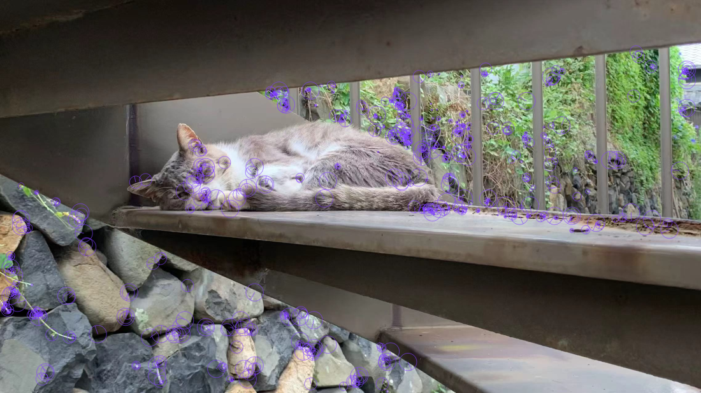

# orb-sift-feature-matching

基于 **C++ / OpenCV** 的特征点检测与匹配项目，包含两部分：

1. **从零实现的 ORB 与 SIFT 特征点检测器** —— 仅借助 OpenCV 的底层算子（resize、FAST、Harris、高斯模糊、Sobel），手动实现图像金字塔、尺度空间极值检测、边缘过滤与主方向计算。
2. **特征匹配与物体定位** —— 在两幅图像间进行描述子匹配（kNN + Lowe ratio test），并用单应矩阵 + RANSAC 估计变换，定位并框出目标物体。

---

## 仓库结构

```
orb-sift-feature-matching/
├── include/custom_features.hpp   # 自实现检测器接口
├── src/
│   ├── custom_orb.cpp            # 从零实现 ORB 检测器（金字塔→FAST→Harris→质心朝向）
│   ├── custom_sift.cpp          # 从零实现 SIFT 检测器（高斯/DoG 金字塔→极值→朝向直方图）
│   ├── detect.cpp               # 演示 1：运行自实现检测器并可视化特征点
│   └── match.cpp                # 演示 2：特征匹配 + 单应矩阵/RANSAC 物体定位
├── assets/scene.jpg             # 示例图像
├── docs/                        # 示例输出
└── CMakeLists.txt
```

---

## 效果展示

**自实现 ORB 特征点检测**（图像金字塔上的 FAST + Harris 角点，箭头表示主方向）：



**特征匹配 + 物体定位**（左：目标物体；右：经透视变换的场景；绿线为匹配的内点，红框为定位出的物体位置）：


---

## 构建

需要 OpenCV ≥ 4.5（`cv::SIFT` 自 4.4 起位于主模块）。

```bash
cmake -B build
cmake --build build --config Release
```

## 运行

```bash
# 演示 1：自实现 ORB / SIFT 检测器，输出特征点可视化
./detect [image]                       # 默认 assets/scene.jpg

# 演示 2：特征匹配 + 物体定位
./match [ORB|SIFT] [object] [scene]    # 默认 ORB、assets/scene.jpg
# 若不提供 scene，将自动用透视变换合成一个场景，使演示可独立运行
```

---

## 说明

- 两个检测器（`custom_orb.cpp` / `custom_sift.cpp`）为**手动实现**，由早期的 Python 原型移植而来，用于展示算法内部机制。
- 匹配与物体定位部分（`match.cpp`）使用 OpenCV 的 ORB/SIFT 描述子 + `BFMatcher` + `findHomography`，演示特征在跨视角下的匹配与目标定位。
- 示例图像 `docs/` 由上述同一套算法生成。

以 [MIT 许可证](LICENSE) 发布。
