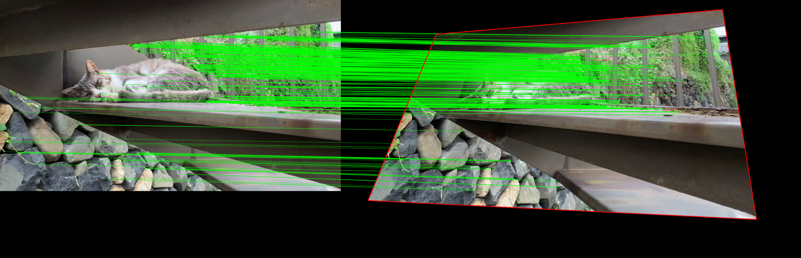

# ORB and SIFT Feature Detection and Matching

A C++ and OpenCV project with two demos. One visualizes custom keypoint detectors. The other matches features between images and localizes an object under a change of perspective.

## Custom keypoint detection

The custom detectors use OpenCV primitives for operations such as resizing, FAST corner detection, Harris scoring, Gaussian filtering, and Sobel gradients. The detection pipelines implement the image pyramids, scale-space or corner selection, and orientation assignment.

- [src/custom_orb.cpp](src/custom_orb.cpp) builds a pyramid, detects and ranks corners, and assigns orientations using intensity centroids.
- [src/custom_sift.cpp](src/custom_sift.cpp) builds Gaussian and Difference-of-Gaussians pyramids, filters scale-space extrema, and assigns orientations with gradient histograms.
- [include/custom_features.hpp](include/custom_features.hpp) declares the detector interfaces. [src/detect.cpp](src/detect.cpp) runs both detectors and visualizes the resulting keypoints.


## Matching and object localization

[src/match.cpp](src/match.cpp) uses OpenCV’s ORB or SIFT descriptors, brute-force k-nearest-neighbor matching, and Lowe’s ratio test. It estimates a homography with RANSAC and projects the object’s corners onto the scene. The visualization shows the inlier matches and the estimated object outline.



## Build and run

Use CMake and OpenCV 4.5 or newer. Run the demos from the repository root so their sample paths resolve.

```sh
cmake -S . -B build
cmake --build build --config Release
./build/detect assets/scene.jpg
./build/match ORB assets/scene.jpg
```

For a Visual Studio generator, run the executables in `build/Release/`. The matcher accepts an optional method (`ORB` or `SIFT`), an object image, and a scene image. With no scene image, it synthesizes a perspective-transformed scene from the object image. Both demos default to `assets/scene.jpg`.

[MIT License](LICENSE)
